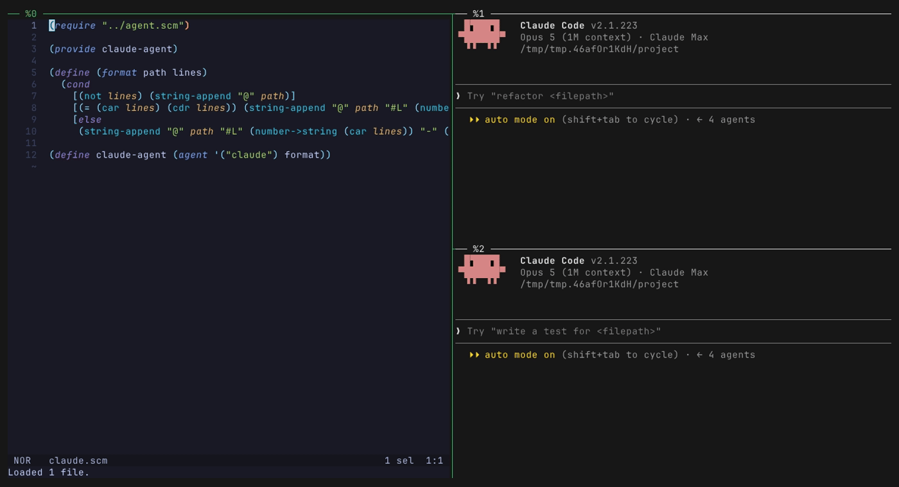

# sidekick.hx

A [Steel](https://github.com/mattwparas/steel) plugin for Helix that sends the current file or selected lines to an AI agent running in another terminal, like [sidekick.nvim](https://github.com/folke/sidekick.nvim).



Agents and terminal multiplexers (muxes) are pluggable; see [Supported agents and muxes](#supported-agents-and-muxes) and [Extending](#extending).

> [!WARNING]
> `:sidekick-attach` uses `#%exp-picker`, Helix's experimental Steel picker API, which may change or go away in a future Helix build.
> That picker can only list files, so sidekick writes one file per terminal to `$XDG_RUNTIME_DIR/sidekick-hx` and closes the buffer the picker opens once you choose.

## Setup

Requires a Helix build with Steel, and the commands a mux needs on `PATH`, listed under [Muxes](#muxes).

```scheme
;; helix.scm
(require "sidekick-hx/sidekick.scm")
(provide sidekick-send-file
         sidekick-send-selection
         sidekick-attach
         sidekick-detach)

;; init.scm
(require (only-in "helix/keymaps.scm" keymap))
(keymap (global)
        (normal (space (a (a ":sidekick-attach")
                          (d ":sidekick-detach")
                          (f ":sidekick-send-file")
                          (s ":sidekick-send-selection"))))
        (select (space (a (s ":sidekick-send-selection")))))
```

## Commands

| Command | Description |
| --- | --- |
| `:sidekick-send-file` | Types a mention of the current file, such as `@src/main.rs`, into the agent's prompt. |
| `:sidekick-send-selection` | Types a mention of the lines each selection covers, such as `@src/main.rs#L10-20`, into the agent's prompt. Multiple selections become multiple mentions. |
| `:sidekick-attach [target]` | Chooses the terminal sends go to. With a target, such as those under [Muxes](#muxes), attaches to it. Without one, opens a picker of the terminals running the agent plus `+ new`, which starts the agent beside Helix. Starts the agent right away when none is running. |
| `:sidekick-detach` | Forgets the attached terminal. |

sidekick finds agents in every running mux, so an agent in any of them can be picked even when one mux runs inside another. Until you attach, sends go to the agent's terminal whose working directory is Helix's. Paths in mentions are relative to the agent's working directory when the file is inside it, and absolute otherwise.

## Supported agents and muxes

### Agents

| Name | Agent | Source |
| --- | --- | --- |
| `claude` (default) | [Claude Code](https://claude.com/claude-code) | [`sidekick/agent/claude.scm`](sidekick/agent/claude.scm) |

### Muxes

| Name | Mux | Requires on `PATH` | Target | New agents start here | Source |
| --- | --- | --- | --- | --- | --- |
| `tmux` | [tmux](https://github.com/tmux/tmux) | `tmux` | Pane, such as `%3` | Inside tmux | [`sidekick/mux/tmux.scm`](sidekick/mux/tmux.scm) |
| `rex` | rex | `rex` | Block, such as `block:01a2…` | Inside rex, outside tmux | [`sidekick/mux/rex.scm`](sidekick/mux/rex.scm) |
| `herdr-app` | [herdr-app](https://herdr.dev) | `hc`, `herdr-app` | Terminal, such as `t9f` | Otherwise | [`sidekick/mux/herdr-app.scm`](sidekick/mux/herdr-app.scm) |

> [!WARNING]
> herdr-app has no way to type text into a terminal without pressing Enter: `hc send` always submits it.
> So with herdr-app, each mention reaches the agent as a prompt of its own, sent right away.
> [herdrdev/herdr-core#215](https://github.com/herdrdev/herdr-core/issues/215) asks for an option to paste without Enter.

## Extending

### Agents

Register an agent under a name, then select it. Muxes find its terminals by the program in `#:cmd`, so an agent started from a shell is found too.

```scheme
(require "sidekick-hx/sidekick.scm")

(sidekick-register-agent! "codex"
  ;; argv that starts the agent
  #:cmd '("codex")
  ;; lines is a (start . end) pair of 1-based line numbers, or #f for the whole file
  #:format (lambda (path lines) (string-append "@" path)))
(sidekick-set-agent! "codex")
```

### Muxes

New agents start in the mux that [Muxes](#muxes) names for where Helix runs. To start them elsewhere:

```scheme
(sidekick-set-mux! "herdr-app")
```

`sidekick-register-mux!` adds a mux; its docstring describes the functions it takes.
